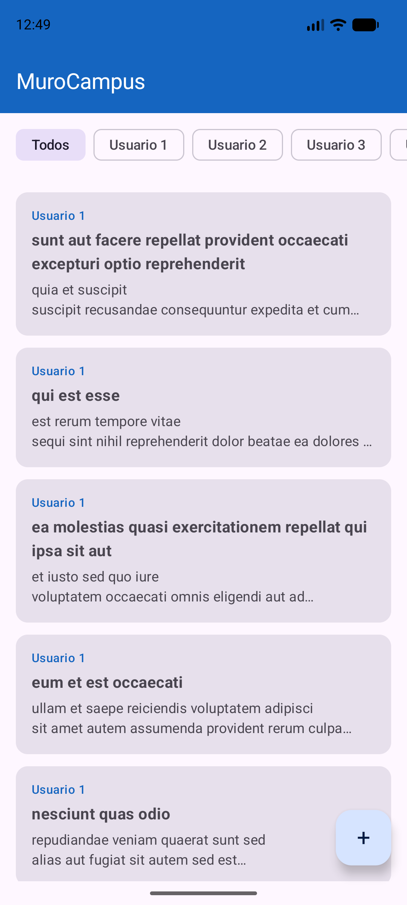
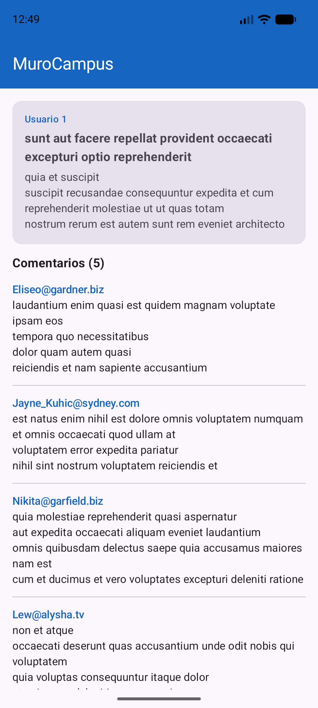
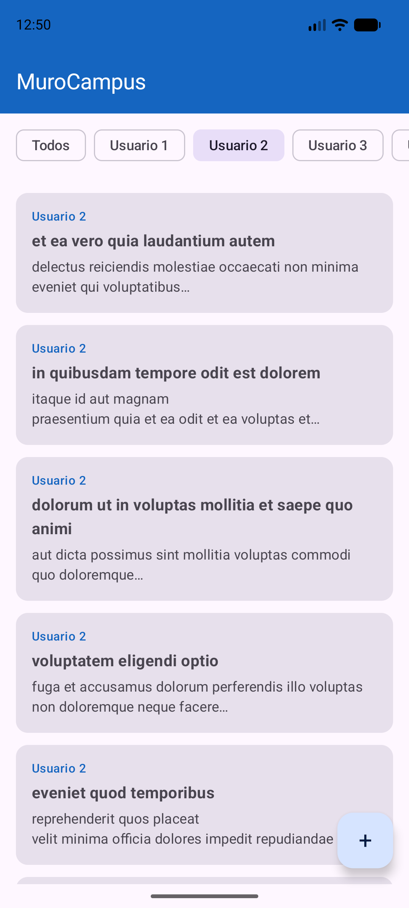
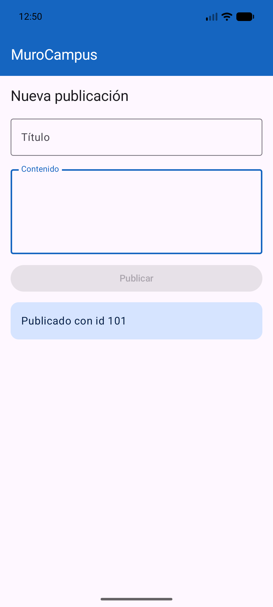
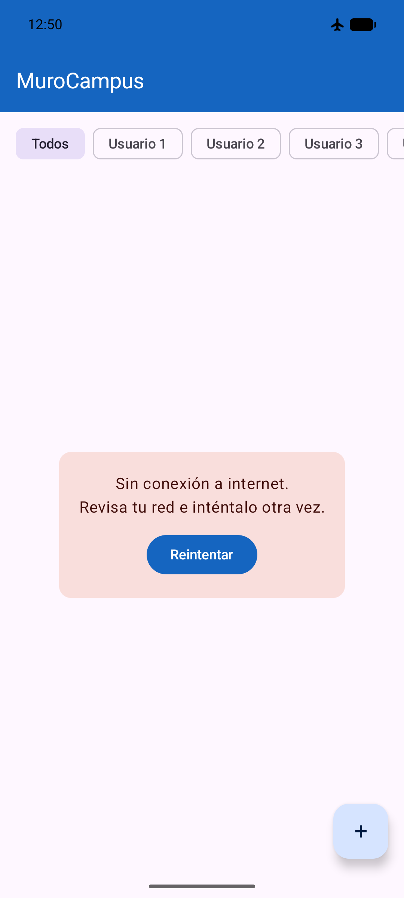

# MuroCampus — Laboratorio 9 (Programación en Móviles)

**Alumno:** Diego Panez Rondinel · **Paquete:** `com.tecsup.murocampus` · **Rama:** `sin-ia` (Fase 1)

App Android en Kotlin con Jetpack Compose que consume el servicio web REST de [JSONPlaceholder](https://jsonplaceholder.typicode.com/). Lista las publicaciones, muestra el detalle con sus comentarios, filtra por usuario y crea una publicación nueva. Funciona sin cerrarse cuando no hay internet: muestra el error y deja reintentar.

## Qué hace

| Función | Llamada | Detalle |
|---|---|---|
| Lista | `GET posts` | 100 publicaciones con los estados Cargando, Éxito y Error |
| Detalle | `GET posts/{id}` y `GET posts/{id}/comments` | Las dos llamadas van a la vez con `async`; si una falla, el detalle muestra el error |
| Filtro | `GET posts?userId=N` | Chips Todos y Usuario 1 a 10 |
| Crear | `POST posts` con el JSON en el cuerpo | Responde «Publicado con id 101» |

## Estructura de paquetes

```
com.tecsup.murocampus/
├── MainActivity.kt                navegación: lista, detalle y crear
├── model/
│   └── Modelos.kt                 Usuario, Post, Comentario y NuevoPost
├── data/
│   ├── remote/
│   │   ├── PostApi.kt             interface de Retrofit (@GET, @POST, @Path, @Query, @Body)
│   │   ├── UsuarioApi.kt          ejemplo resuelto
│   │   └── RetrofitClient.kt      Retrofit + OkHttp + kotlinx.serialization
│   ├── PostRepository.kt          interface + PostRepositoryRemote (devuelve Result)
│   └── UsuarioRepository.kt       ejemplo resuelto
├── viewmodel/
│   ├── UiState.kt                 Cargando / Exito / Error y mensajeDe()
│   ├── PostsViewModel.kt          lista, detalle, filtro y crear
│   └── PostsViewModelFactory.kt
└── ui/
    ├── Componentes.kt             TarjetaPost, Cargando y ErrorConReintento
    ├── PantallaLista.kt
    ├── PantallaDetalle.kt
    ├── PantallaCrear.kt
    └── theme/
```

## Arquitectura MVVM + Repository

```
View (PantallaLista, PantallaDetalle, PantallaCrear)
   |  eventos: cargar, filtrar, abrir, publicar     ^  collectAsStateWithLifecycle()
   v                                                |
ViewModel (PostsViewModel)  --- StateFlow<UiState> (Cargando / Exito / Error) --->
   |  viewModelScope.launch
   v
PostRepository (interface)  <- devuelve Result<...>
   -> PostRepositoryRemote   (captura IOException, HttpException...)
   |
   v
PostApi (Retrofit) --- OkHttp ---> https://jsonplaceholder.typicode.com/
```

- **View:** solo dibuja el estado con un `when` y avisa los eventos. Nunca llama a la API.
- **ViewModel:** conoce solo la interface `PostRepository`. No usa Retrofit, `PostApi` ni `Context`.
- **Repository:** hace las llamadas y nunca deja escapar una excepción: la convierte en `Result.failure`. La cancelación (`CancellationException`) sí se vuelve a lanzar.

## Capturas

| Lista | Detalle | Filtro |
|---|---|---|
|  |  |  |

| Crear | Error de conexión |
|---|---|
|  |  |

## Pruebas del Paso 10

| Prueba | Cómo se provocó | Resultado |
|---|---|---|
| Sin internet | Modo avión y abrir la app | «Sin conexión a internet» y botón Reintentar ✔ |
| Reintentar | Quitar el modo avión y pulsar Reintentar | Carga la lista ✔ |
| Recurso inexistente | Pedir el detalle del id 9999 (temporal) | «Error del servidor (404)» ✔ |
| JSON inesperado | Quitar `name` de `Comentario` (temporal) | Funciona, gracias a `ignoreUnknownKeys` ✔ |
| JSON inesperado | Agregar a `Post` un campo que no llega (temporal) | «Respuesta inesperada» ✔ |
| Cancelación | Abrir el detalle y volver rápido | Sin errores en Logcat ✔ |
| Lista y detalle | Abrir varias publicaciones | Siempre 5 comentarios ✔ |
| Filtro | Elegir cada usuario del 1 al 10 | Siempre 10 publicaciones ✔ |
| Crear | Enviar una publicación | «Publicado con id 101» y en Logcat el POST con respuesta 201 ✔ |
| Código | Revisar `PostsViewModel` | Sin Retrofit, `PostApi` ni `HttpException` ✔ |

Otras comprobaciones: al rotar la pantalla la lista no se vuelve a descargar, el botón Atrás vuelve del detalle a la lista sin recargarla y, si falla el POST, el formulario conserva lo escrito.

> Para la prueba del 404 se cambió el id que pide el ViewModel y no la ruta de `PostApi`: si la ruta fuera `posts/9999`, el `@Path("id")` se quedaría sin `{id}` y Retrofit fallaría antes de llamar al servidor.

## Para pensar

**1. ¿Qué diferencia hay entre GET y POST? ¿Por qué crear lleva `@Body` y porUsuario lleva `@Query`?**
GET lee datos y no cambia nada en el servidor; POST envía datos para crear algo nuevo. Crear necesita mandar un objeto completo (título, contenido, usuario), y eso viaja como JSON en el cuerpo con `@Body`. porUsuario solo lee y necesita un dato pequeño para filtrar, que va en la URL después de `?` con `@Query`: `posts?userId=2`.

**2. ¿Por qué la ruta es `"posts"` y no `"/posts"`?**
Porque Retrofit une la ruta con la URL base. Si la ruta empieza con `/`, se considera absoluta y reemplaza el camino de la URL base. Con `"posts"` se agrega al final de `https://jsonplaceholder.typicode.com/`, que por eso termina en `/`.

**3. ¿Por qué el Repository devuelve `Result` en vez de dejar que la excepción llegue al ViewModel?**
Para que el ViewModel no tenga que conocer los errores de red (`IOException`, `HttpException`) ni llenarse de `try/catch`. El `Result` obliga a manejar el éxito y el fallo con `onSuccess` y `onFailure`, y el ViewModel solo lo convierte en un `UiState`. Así, si cambia la fuente de datos, el ViewModel y la pantalla no cambian.

**4. ¿Qué pasa si olvidas el permiso INTERNET? ¿Y si olvidas `ignoreUnknownKeys` y el servidor agrega un campo nuevo?**
Sin el permiso, la app compila pero ninguna llamada sale: falla con un error de red y muestra «Sin conexión» aunque haya internet. Sin `ignoreUnknownKeys`, cualquier campo nuevo del servidor que no esté en la `data class` produce una `SerializationException` y la app muestra «Respuesta inesperada».

**5. ¿Por qué la pantalla de lista usa un `when` sobre `UiState` y no un `if` con tres variables?**
Con tres variables (cargando, datos, error) se pueden dar combinaciones imposibles, como cargando y error a la vez. Un `sealed interface` solo puede estar en un estado, y el `when` obliga a dibujar los tres casos; si falta uno, no compila.

**6. JSONPlaceholder no guarda los POST. ¿Cómo cambiaría tu app con un servicio real?**
Después de publicar habría que volver a cargar la lista, o agregar la publicación devuelta a la lista local, para que aparezca. Además, el servicio real pediría autenticación (por ejemplo, un token en un encabezado), validaría los datos y podría responder con errores 400 o 401, que habría que mostrar al usuario.
