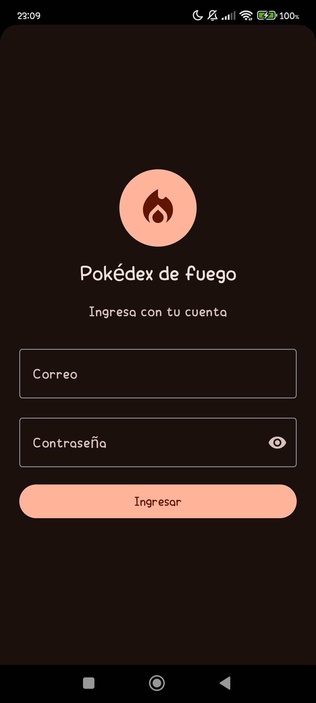
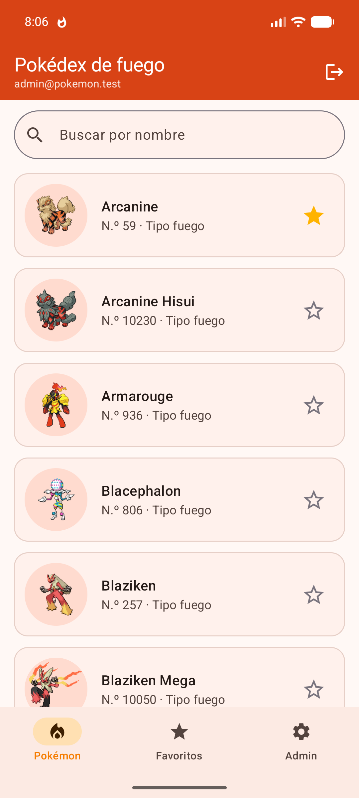
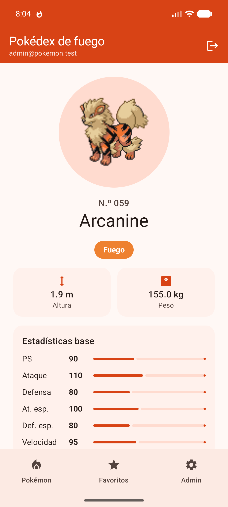
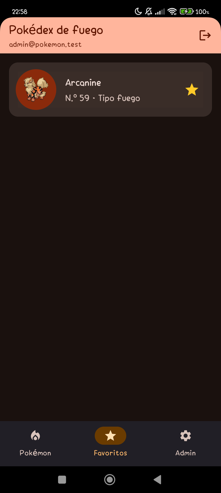
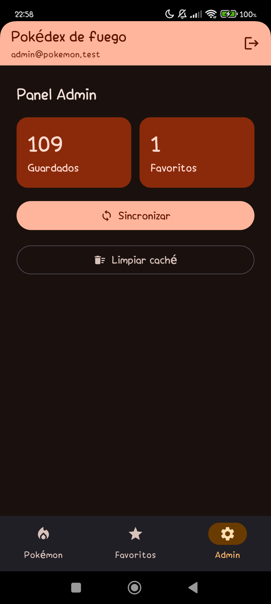
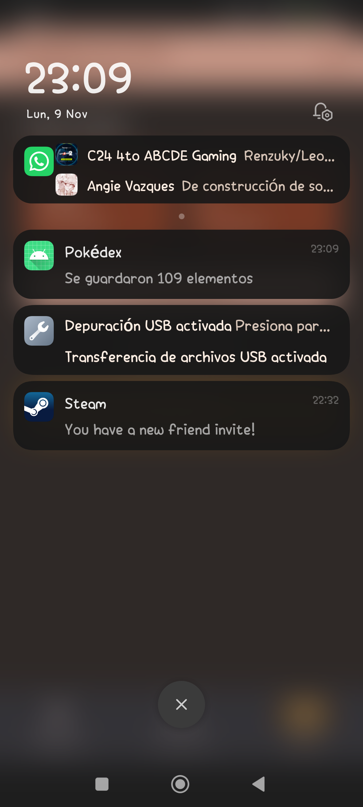

# Pokédex — Laboratorio 12 (Programación en Móviles)

App Android en Kotlin con Jetpack Compose (Material 3) que muestra los Pokémon de tipo **fuego** desde internet, los guarda en el celular y permite marcar favoritos.

**Integrantes:** Victor y Diego Panez · **Tema:** Pokémon, variante fuego · **API:** [PokeAPI](https://pokeapi.co/api/v2/) (sin clave)

## Qué hace

| Función | Estado |
|---|---|
| Lista de Pokémon de fuego con estados Cargando, Error (con *Reintentar*) y Vacío | Hecho |
| Detalle de un Pokémon con el segundo endpoint (`pokemon/{nombre}`) | Hecho |
| Room como fuente de verdad (Entity, Dao, Database) y modo sin conexión | Hecho |
| Favoritos: marcar, desmarcar y pantalla Favoritos (se conservan al cerrar la app) | Hecho |
| Panel Admin (solo administrador): totales, *Sincronizar* y *Limpiar caché* | Hecho |
| Login con Firebase Authentication, sesión guardada, cerrar sesión y roles desde Firestore (`usuarios/{uid}`, campo `rol`) | Hecho |
| Notificación local «Se guardaron N elementos» al sincronizar | Hecho |
| Búsqueda por nombre en la lista (Fase 2) | Hecho |
| Detalle con chips de tipos, altura, peso y estadísticas base (Fase 2) | Hecho |

## Endpoints

- Lista: `GET type/fire` → `pokemon[].pokemon.{name, url}`
- Detalle: `GET pokemon/{nombre}`

El id de cada elemento es el nombre del Pokémon (texto).

## Arquitectura (MVVM)

```
com.tecsup.pokemon/
├── data/
│   ├── remote/        ApiService, RetrofitClient, DTO
│   ├── local/         ItemEntity, ItemDao, AppDatabase (Room)
│   ├── mapper/        Dto → Entity → modelo
│   ├── repository/    ItemRepository (interface) + ItemRepositoryImpl
│   └── auth/          AuthRepository (interface)
├── domain/model/      Item, Sesion y Rol
├── notification/      Notificador (interface)
└── ui/
    ├── UiState.kt     Cargando · Exito · Error
    ├── navigation/    AppNav
    ├── lista/ detalle/ favoritos/ admin/    Screen + ViewModel de cada pantalla
    └── components/    Cargando, ErrorView
```

- Las pantallas solo observan un `StateFlow<UiState>` y llaman funciones del ViewModel.
- El ViewModel depende del repositorio como **interface**; Room es la fuente de verdad y Retrofit solo la actualiza con `refrescar()`.
- El panel Admin solo existe en la navegación cuando la sesión tiene el rol `ADMIN`.

## Pruebas

Pruebas unitarias de los ViewModel con un repositorio falso en memoria (`FakeItemRepository`), sin red ni Room:

- `ListaViewModelTest` (7): datos guardados, sin internet sin datos, sin internet con datos, reintentar, favorito, aviso «Se guardaron N» al sincronizar y sin aviso si no hay internet.
- `DetalleViewModelTest` (4): carga, sin internet, error HTTP y favorito.
- `FavoritosViewModelTest` (2): solo favoritos y quitar un favorito.
- `AdminViewModelTest` (4): totales, sincronizar con aviso, sincronizar sin internet y limpiar caché.

```bash
./gradlew :app:testDebugUnitTest
```

## Cómo ejecutarlo

1. Abrir la carpeta `Semana_12/Lab12` en Android Studio.
2. Tener internet en el emulador o el celular.
3. Ejecutar la configuración `app`.

`google-services.json` (Firebase) no se sube al repositorio: se coloca en `app/` (lo crea quien tiene el proyecto de Firebase y se lo pasa al otro por privado). Sin ese archivo la app no compila.

## Usuarios de prueba (Firebase)

El rol no se decide en la app: se guarda en Firestore y la app lo lee después de ingresar.

1. En la consola de Firebase, **Authentication → Método de acceso**: activar *Correo electrónico/contraseña*.
2. **Authentication → Usuarios**: crear dos cuentas, una de administrador y una de usuario.
3. **Firestore Database**: crear la colección `usuarios` con un documento por cuenta. El **ID del documento es el UID** de la cuenta (se copia desde Authentication → Usuarios) y tiene los campos `rol` (`admin` o `usuario`) y `nombre`.
4. Pegar las reglas de `firestore.rules` y publicarlas.
5. Registrar la app Android con el paquete `com.tecsup.pokemon` y descargar `google-services.json` a `app/`.

Si el rol siempre sale `usuario`, casi siempre es porque el ID del documento no es el UID.

## Reparto de tareas

| Integrante | Fase 1 (`sin-ia`) | Fase 2 (`con-ia`) |
|---|---|---|
| **Victor** | C01 proyecto base · C03 modelo, `UiState` y componentes · C04 lista · C07 detalle · C08 Room (Entity, Dao, Database) · C10 favoritos · C14 panel Admin · pruebas de los ViewModel · README | Base de la fase con IA · README y `PROMPTS.md` (consultas 1 a 6) · rediseño con Material 3 (tema de fuego, imágenes con Coil, iconos) · capturas |
| **Diego Panez** | C02 estructura y contratos · C05 Retrofit · C06 Repository y lista con la API · C09 Room como fuente de verdad · C11 modo sin conexión · C12 Firebase · C13 login y sesión · C15 notificación | Tarjetas sin doble borde y tonos del tema · detalle con tipos, medidas y estadísticas · búsqueda por nombre · `PROMPTS.md` (consultas 7 a 9) |

## Capturas

Tomadas con la sesión del administrador. La lista y el detalle muestran las mejoras de la Fase 2 (búsqueda y estadísticas).

| Login | Lista |
|---|---|
|  |  |

| Detalle | Favoritos |
|---|---|
|  |  |

| Panel Admin | Notificación al sincronizar |
|---|---|
|  |  |

## Fases

- **Fase 1, sin IA:** rama `sin-ia`.
- **Fase 2, con IA:** rama `con-ia`, con `PROMPTS.md`.
