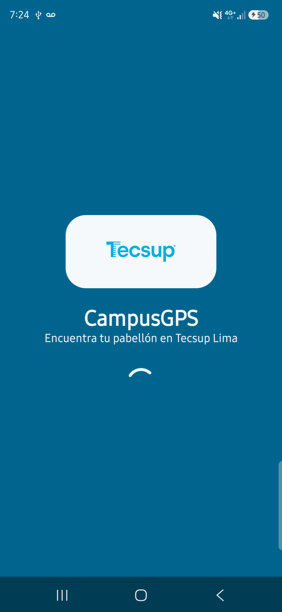
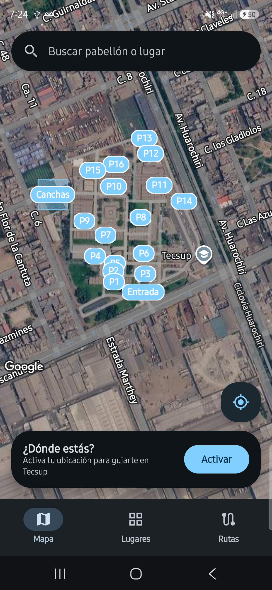
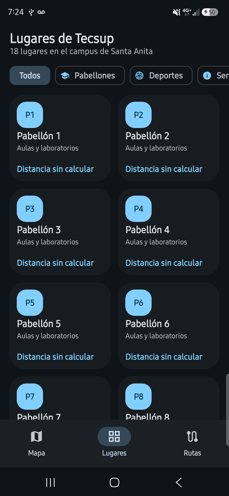
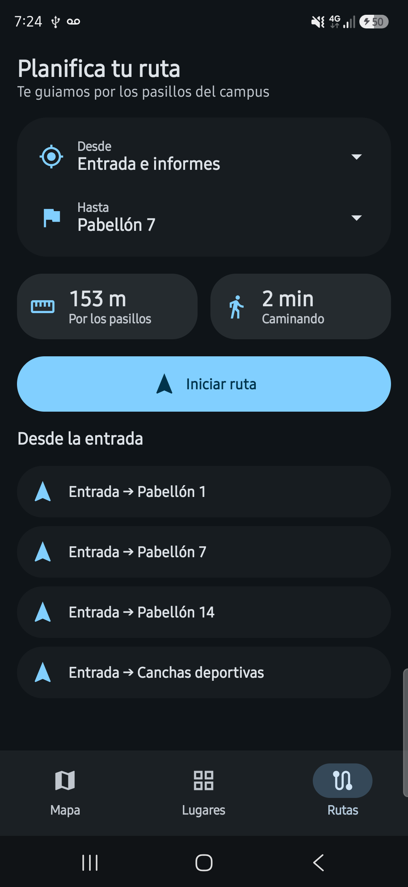
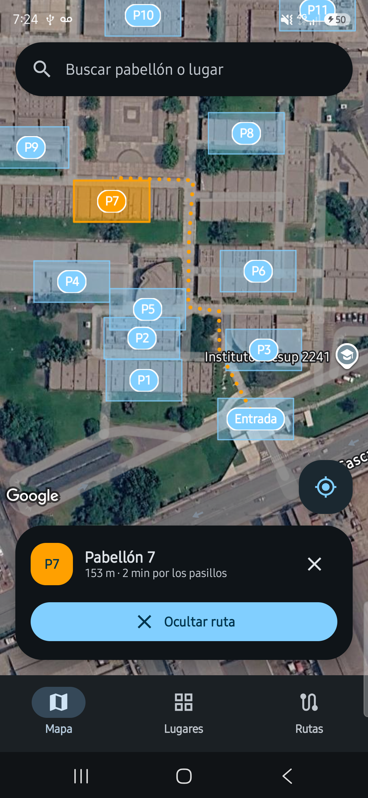
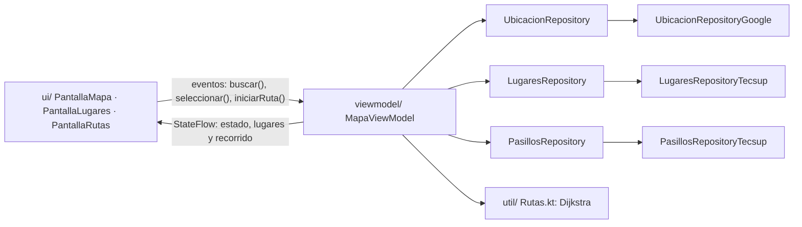
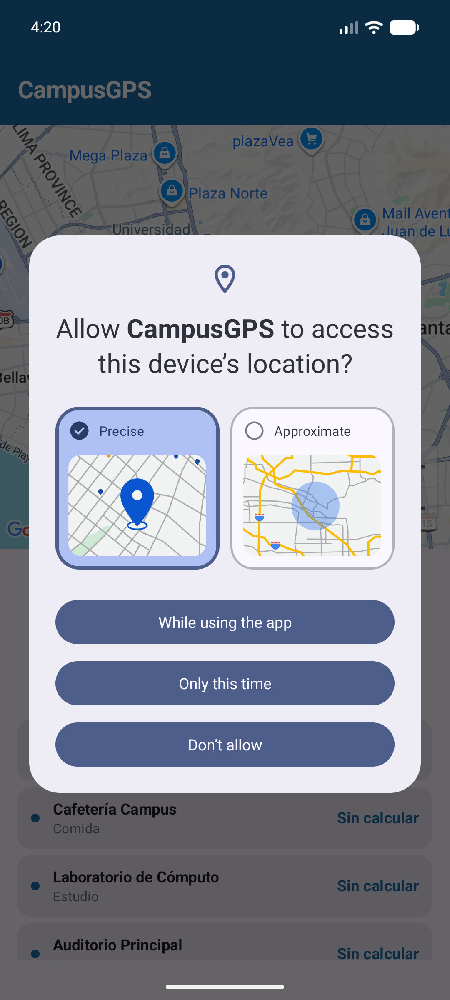
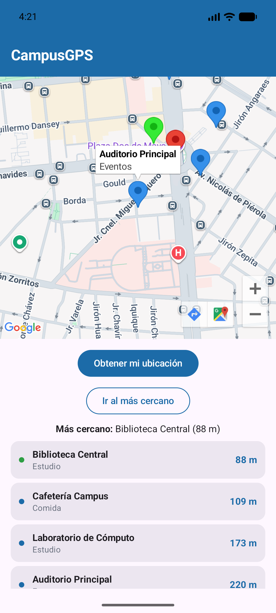
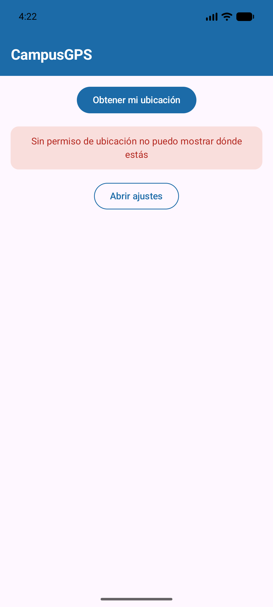

# CampusGPS — Laboratorio 13 (Programación en Móviles)

**Alumno:** Diego Panez Rondinel · **Paquete:** `com.panez.campusgps` · **Rama:** `con-ia` (Fase 2)

Guía del campus de **Tecsup Lima (Santa Anita)** para Android, hecha en Kotlin con Jetpack Compose. Muestra los pabellones sobre Google Maps, busca lugares y traza rutas a pie **por los pasillos del campus**.

La Fase 1, con los 5 lugares ficticios de la guía, está en la rama [`sin-ia`](https://github.com/diegoz-netizen/ProgramacionMoviles_Panez/tree/sin-ia/Lab13). El análisis del uso de IA está en [PROMPTS.md](PROMPTS.md).

## Capturas de la Fase 2

| Splash | Mapa | Lugares |
|---|---|---|
|  |  |  |

| Rutas | Ruta en el mapa |
|---|---|
|  |  |

## Qué agrega la Fase 2

| Mejora | Detalle |
|---|---|
| Campus real | 16 pabellones, canchas y entrada de Tecsup Lima |
| Diseño propio | Tema Tecsup con Material 3 y splash con el logo |
| Tres pestañas | **Mapa**, **Lugares** y **Rutas** |
| Plano del campus | Bloques de color con la etiqueta de cada pabellón |
| Búsqueda y filtros | Por nombre o número (`P7`) y por categoría |
| Rutas por pasillos | Red de 33 puntos y camino más corto con Dijkstra |
| Distancia real | Metros y minutos a pie medidos sobre el recorrido |
| Uso en el campus | Desde «Mi ubicación», la ruta se activa a menos de 100 m de los pasillos |

**Pendiente:** inicio de sesión con Google limitado a `@tecsup.edu.pe`, puerta exacta de cada pabellón y prueba de la ruta caminando dentro del campus.

## Estructura de paquetes

```
com.panez.campusgps/
├── MainActivity.kt
├── model/
│   ├── Modelos.kt                    Posicion, Lugar, LugarConDistancia, TipoError, UbicacionUi
│   └── RedPasillos.kt                Nodo, RedPasillos, Recorrido
├── data/
│   ├── UbicacionRepository.kt        interface
│   ├── UbicacionRepositoryGoogle.kt  FusedLocationProviderClient
│   ├── LugaresRepository.kt          interface
│   ├── LugaresRepositoryLocal.kt     lugares ficticios de la Fase 1
│   ├── LugaresRepositoryTecsup.kt    lugares reales del campus
│   ├── PasillosRepository.kt         interface y red de Tecsup
│   └── RedBaseTecsup.kt              puntos y tramos de los pasillos
├── util/
│   ├── Distancia.kt                  distanciaMetros()
│   ├── Formato.kt                    formatearDistancia(), minutosAPie()
│   └── Rutas.kt                      Haversine y Dijkstra
├── viewmodel/
│   ├── MapaViewModel.kt              estado de las pantallas y lógica
│   └── CampusViewModelFactory.kt
└── ui/
    ├── PantallaSplash.kt             inicio con el logo
    ├── PantallaMapa.kt               pestañas, permiso y mapa
    ├── PantallaLugares.kt            directorio de lugares
    ├── PantallaRutas.kt              planificador de rutas
    ├── MapaUbicacion.kt              GoogleMap con plano y ruta
    ├── EtiquetaMapa.kt               etiquetas del plano
    ├── MensajeError.kt               mensaje con Reintentar o Abrir ajustes
    ├── components/                   componentes reutilizables
    └── theme/                        colores, tipografía, formas y medidas
```

## Arquitectura MVVM + Repository



La pantalla solo dibuja el estado y avisa los toques. El ViewModel recibe interfaces, no conoce `Context` y calcula la ruta con funciones puras de `util/`.

## Cómo se calcula la ruta

1. Se busca el punto del pasillo más cercano al origen y el que queda frente al destino.
2. Esos dos puntos se agregan temporalmente al grafo de pasillos.
3. Dijkstra encuentra el camino más corto entre ellos.
4. La distancia es la suma de los tramos, y el tiempo usa unos 80 m por minuto.

Las pruebas están en `app/src/test/.../util/RutasTest.kt` (9 pruebas):

```bash
./gradlew :app:testDebugUnitTest
```

## Clave de Google Maps

La clave **no está en el código**. Se pone en `local.properties`, que no se sube:

```
MAPS_API_KEY=tu_clave
```

`app/build.gradle.kts` la lee y la pasa al `AndroidManifest.xml` con `manifestPlaceholders`. En Google Cloud está restringida al paquete, a la huella SHA-1 y a *Maps SDK for Android*.

## Capturas de la Fase 1

| Permiso | Mapa con mi ubicación | Marcadores |
|---|---|---|
|  |  |  |

| Lista ordenada | Error (permiso denegado) |
|---|---|
|  |  |

## Para pensar

**1. ¿Por qué `FusedLocationProviderClient` está dentro del Repository y no en el ViewModel?**
Porque es una clase de Android que necesita `Context` y Google Play Services. El ViewModel no debe conocer `Context` ni depender de una librería concreta: pide la posición a la interface `UbicacionRepository` (`obtenerPosicion()`). Así se puede cambiar la fuente de ubicación o usar un repositorio falso en las pruebas sin tocar el ViewModel.

**2. ¿Qué diferencia hay entre el permiso de ubicación y la clave de API de Maps? ¿Qué pasa si falta cada uno?**
El **permiso** lo da el usuario y autoriza a la app a leer el GPS del celular. La **clave** la da Google Cloud y autoriza a la app a usar el servicio de mapas. Sin permiso, la app no sabe dónde estás: muestra el mensaje con *Abrir ajustes*. Sin clave (o con una clave inválida), el mapa sale gris o en blanco, aunque la ubicación y la lista de distancias sí funcionan.

**3. ¿Por qué la clave va en `local.properties` y no en el código? ¿Qué harías si se subiera a GitHub por error?**
Porque `local.properties` no se sube al repositorio y la clave no queda pública. Si se subiera por error: la borraría y la regeneraría en Google Cloud (la vieja queda expuesta en el historial aunque se borre el archivo), y la dejaría restringida al paquete `com.panez.campusgps` con la huella SHA-1 y solo a *Maps SDK for Android*.

**4. ¿Dónde calculas la distancia y por qué no en el Composable?**
En el ViewModel (`MapaViewModel.actualizarDistancias()`), usando `distanciaMetros()` de `util/Distancia.kt`. Si se calculara en el Composable, se repetiría en cada recomposición y la pantalla tendría lógica, lo que rompe MVVM. En el ViewModel se calcula una sola vez por ubicación y la pantalla solo recibe la lista ya ordenada.

**5. ¿Qué pasa con tu app si el usuario niega el permiso dos veces? ¿Cómo lo manejas?**
Desde la segunda negativa Android ya no vuelve a mostrar el cuadro de permiso. La app no se cierra: el ViewModel pasa al estado de error `SIN_PERMISO` y la pantalla muestra el mensaje con el botón **Abrir ajustes**, que abre la configuración de la app (`Settings.ACTION_APPLICATION_DETAILS_SETTINGS`) para que el usuario active el permiso a mano.

## Cómo ejecutarlo

1. Abrir la carpeta `Lab13` en Android Studio.
2. Poner la clave en `local.properties` (`MAPS_API_KEY=...`).
3. Ejecutar en un celular o en un emulador con Google Play. Para probar en el emulador, fijar la ubicación dentro del campus: `-12.0447, -76.9525`.

## Informe

[Lab13_CampusGPS_Diego_Panez.docx](Lab13_CampusGPS_Diego_Panez.docx)
