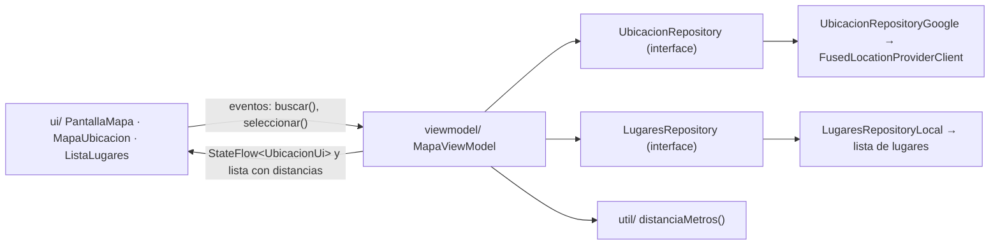
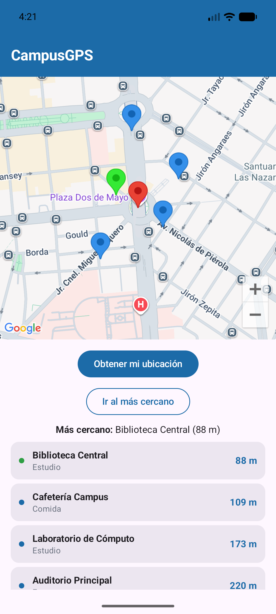
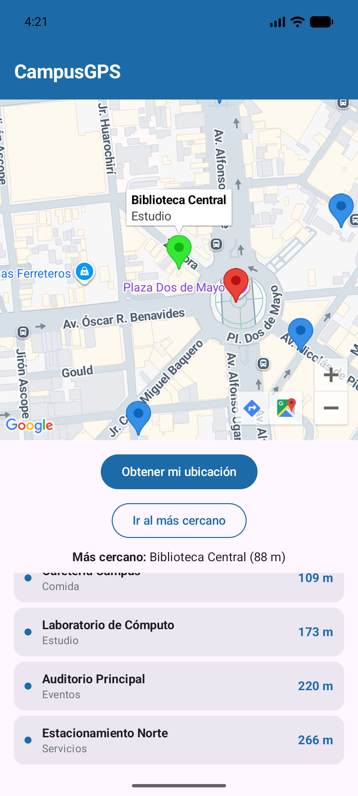

# CampusGPS — Laboratorio 13 (Programación en Móviles)

**Alumno:** Diego Panez · **Paquete:** `com.panez.campusgps`

App Android en Kotlin con Jetpack Compose que pide el permiso de ubicación, muestra tu posición en Google Maps, marca los lugares del campus, calcula a qué distancia está cada uno, los ordena de más cerca a más lejos y te lleva al más cercano.

## Qué hace

| Función | Estado |
|---|---|
| Permiso de ubicación en tiempo de ejecución | Hecho |
| Mapa con el marcador «Estás aquí» (latitud y longitud en el globo) | Hecho |
| Marcadores de los 5 lugares del campus (nombre y categoría al tocarlos) | Hecho |
| Distancia a cada lugar y lista ordenada (en m o km) | Hecho |
| Tocar una tarjeta: la cámara viaja al lugar y la tarjeta queda resaltada | Hecho |
| «Ir al más cercano»: marcador verde y cámara al lugar | Hecho |
| Errores: permiso denegado (con *Abrir ajustes*), GPS apagado (con *Reintentar*) y sin Play Services | Hecho |

## Estructura de paquetes

```
com.panez.campusgps/
├── MainActivity.kt
├── model/
│   └── Modelos.kt                    Posicion, Lugar, LugarConDistancia, TipoError, UbicacionUi
├── data/
│   ├── UbicacionRepository.kt        interface
│   ├── UbicacionRepositoryGoogle.kt  implementación con FusedLocationProviderClient
│   ├── LugaresRepository.kt          interface
│   └── LugaresRepositoryLocal.kt     lugares del campus en memoria
├── util/
│   ├── Distancia.kt                  distanciaMetros()
│   └── Formato.kt                    formatearDistancia() → "88 m" / "1.2 km"
├── viewmodel/
│   ├── MapaViewModel.kt              estado de la pantalla y lógica
│   └── CampusViewModelFactory.kt
└── ui/
    ├── PantallaMapa.kt               pantalla principal y permiso
    ├── MapaUbicacion.kt              GoogleMap con marcadores
    ├── ListaLugares.kt               tarjetas ordenadas por distancia
    ├── MensajeError.kt               mensaje con Reintentar o Abrir ajustes
    └── theme/
```

## Arquitectura MVVM + Repository



La pantalla solo dibuja el estado y avisa los toques. El ViewModel pide la posición al repositorio, calcula y ordena las distancias, y publica el resultado en un `StateFlow`. Los repositorios son interfaces, así el ViewModel no depende de Google Play Services.

## Clave de Google Maps

La clave **no está en el código**. Se pone en `local.properties` (que no se sube):

```
MAPS_API_KEY=tu_clave
```

`app/build.gradle.kts` la lee y la pasa al `AndroidManifest.xml` con `manifestPlaceholders` (`${MAPS_API_KEY}`).

## Capturas

| Permiso | Mapa con mi ubicación | Marcadores |
|---|---|---|
|  |  |  |

| Lista ordenada | Error (permiso denegado) |
|---|---|
|  |  |

## Para pensar

**1. ¿Por qué `FusedLocationProviderClient` está dentro del Repository y no en el ViewModel?**
Porque es una clase de Android que necesita `Context` y Google Play Services. El ViewModel no debe conocer `Context` ni depender de una librería concreta: pide la posición a la interface `UbicacionRepository` (`obtenerPosicion()`). Así se puede cambiar la fuente de ubicación o usar un repositorio falso en las pruebas sin tocar el ViewModel.

**2. ¿Qué diferencia hay entre el permiso de ubicación y la clave de API de Maps? ¿Qué pasa si falta cada uno?**
El **permiso** lo da el usuario y autoriza a la app a leer el GPS del celular. La **clave** la da Google Cloud y autoriza a la app a usar el servicio de mapas. Sin permiso, la app no sabe dónde estás: muestra el mensaje con *Abrir ajustes*. Sin clave (o con una clave inválida), el mapa sale gris o en blanco, aunque la ubicación y la lista de distancias sí funcionan.

**3. ¿Por qué la clave va en `local.properties` y no en el código? ¿Qué harías si se subiera a GitHub por error?**
Porque `local.properties` no se sube al repositorio y la clave no queda pública. Si se subiera por error: la borraría y la regeneraría en Google Cloud (la vieja queda expuesta en el historial aunque se borre el archivo), y la dejaría restringida al paquete `com.panez.campusgps` con la huella SHA-1 y solo a *Maps SDK for Android*.

**4. ¿Dónde calculas la distancia y por qué no en el Composable?**
En el ViewModel (`MapaViewModel.actualizarDistancias()`), usando `distanciaMetros()` de `util/Distancia.kt`. Si se calculara en el Composable, se repetiría en cada recomposición y la pantalla tendría lógica, lo que rompe MVVM. En el ViewModel se calcula una sola vez por ubicación y la pantalla solo recibe la lista ya ordenada.

**5. ¿Qué pasa con tu app si el usuario niega el permiso dos veces? ¿Cómo lo manejas?**
Desde la segunda negativa Android ya no vuelve a mostrar el cuadro de permiso. La app no se cierra: el ViewModel pasa al estado de error `SIN_PERMISO` y la pantalla muestra el mensaje con el botón **Abrir ajustes**, que abre la configuración de la app (`Settings.ACTION_APPLICATION_DETAILS_SETTINGS`) para que el usuario active el permiso a mano.

## Cómo ejecutarlo

1. Abrir la carpeta `Lab13` en Android Studio.
2. Poner la clave en `local.properties` (`MAPS_API_KEY=...`).
3. Ejecutar en un emulador con Google Play. Para probar, fijar la ubicación del emulador en `-12.0464, -77.0428`.
