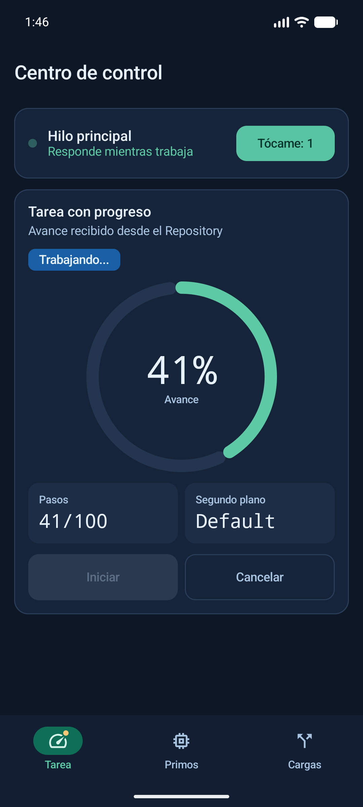
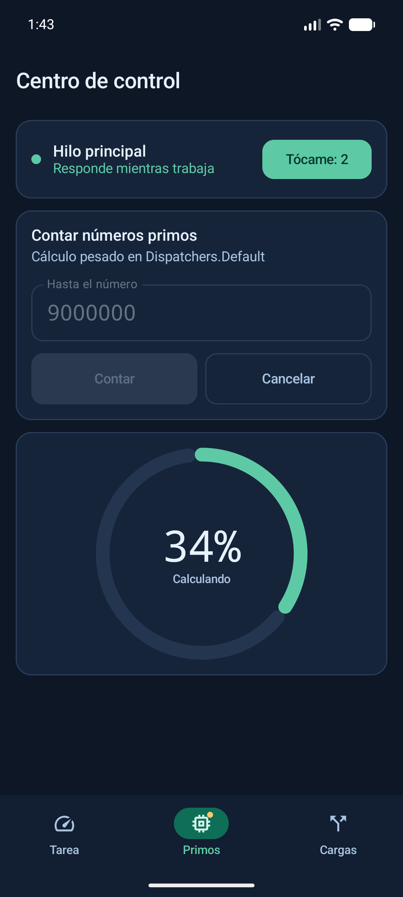
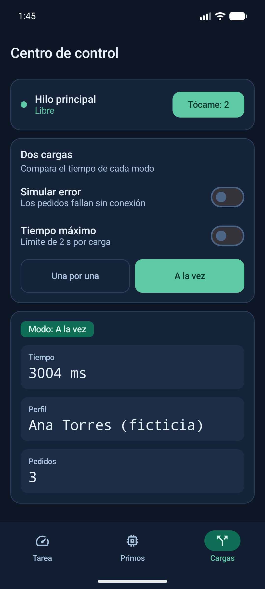
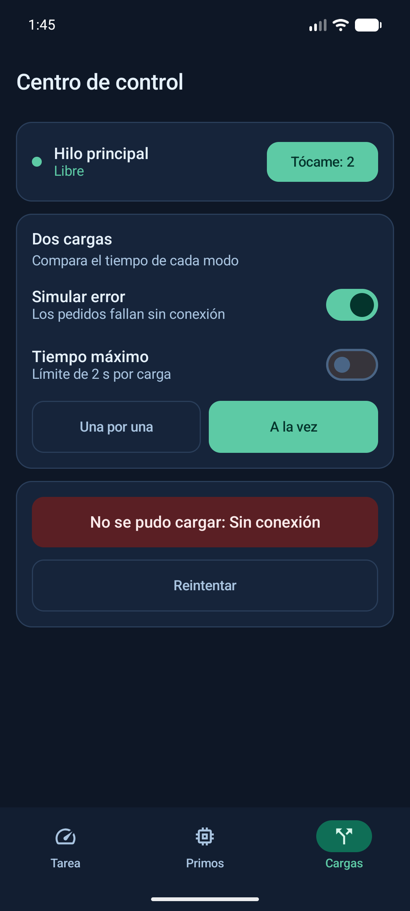
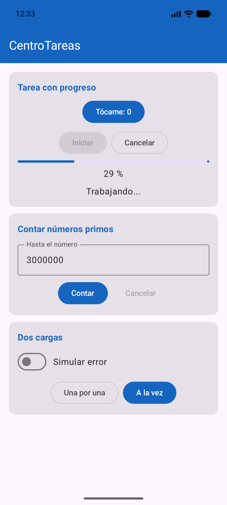
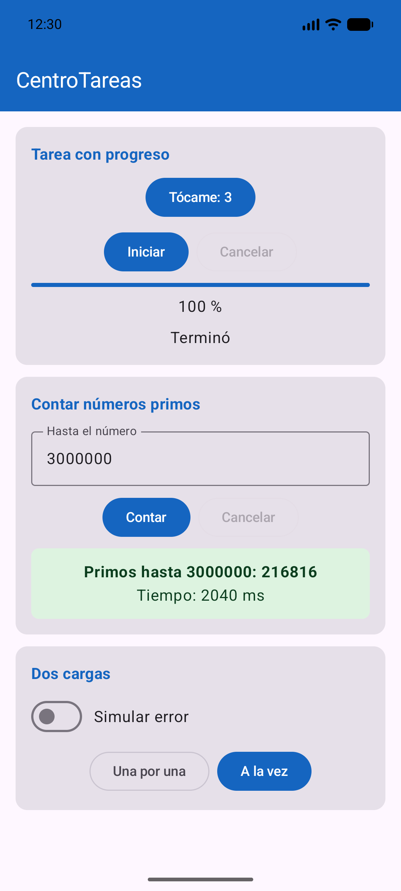
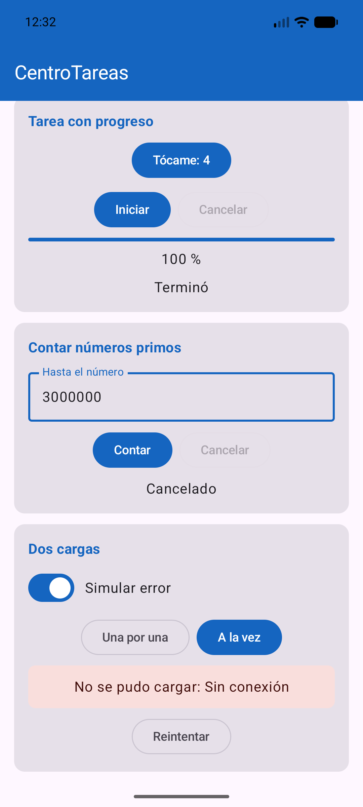

# CentroTareas — Laboratorio 14 (Programación en Móviles)

**Alumno:** Diego Panez Rondinel · **Paquete:** `com.panez.centrotareas` · **Rama:** `con-ia` (Fase 2)

App Android en Kotlin con Jetpack Compose y Material 3 que ejecuta tres trabajos que tardan sin congelar la pantalla: una tarea con progreso, un cálculo pesado de números primos y dos cargas de datos simuladas. Todo el trabajo largo corre con corrutinas y se puede seguir desde la interfaz.

La Fase 1, hecha según la guía, está en la rama [`sin-ia`](https://github.com/diegoz-netizen/ProgramacionMoviles_Panez/tree/sin-ia/Lab14). El registro del uso de IA en la Fase 2 está en [PROMPTS.md](PROMPTS.md).

## Qué hace

| Función | Detalle |
|---|---|
| Prueba de vida | El botón «Tócame» sigue sumando mientras la app trabaja |
| Tarea con progreso | Indicador de 0 a 100 %, con Iniciar y Cancelar |
| Números primos | Cuenta los primos hasta N en `Dispatchers.Default` y se puede cancelar |
| Dos cargas | Compara «Una por una» (≈ 5 s) con «A la vez» usando `async` (≈ 3 s) |
| Errores | «Simular error» muestra el recuadro rojo y el botón Reintentar |

## Qué agrega la Fase 2

| Mejora | Detalle |
|---|---|
| Progreso desde el Repository | `progresoTarea()` emite el avance como `Flow<Float>` con `flowOn(Dispatchers.Default)` |
| Tiempo máximo | `withTimeout` limita cada carga a 2 s y muestra «Tardó demasiado» |
| Primos con progreso | El porcentaje del cálculo se actualiza en tiempo real |
| Diseño propio | Identidad «Sala de control» con tema, componentes y navegación inferior |

Los pedidos tardan 3 s, así que con «Tiempo máximo» encendido las cargas terminan en «Tardó demasiado». Al apagarlo se comparan los 5 s de «Una por una» con los 3 s de «A la vez».

## Sistema de diseño: Sala de control

La rama `con-ia` reemplaza la pantalla única de tarjetas por un panel técnico que vigila los trabajos de la app.

| Decisión | Elección |
|---|---|
| Personalidad | Técnica, precisa y tranquila, como un panel de instrumentos |
| Color | Azul noche de fondo, menta para la acción y ámbar para el trabajo activo |
| Formas | Paneles de 16 dp y botones de 12 dp |
| Tipografía | Roboto para textos y letra monoespaciada para las cifras |
| Navegación | Barra inferior con Tarea, Primos y Cargas |
| Estado | El panel «Hilo principal» siempre visible y un punto ámbar en la sección que está trabajando |

| Tarea | Primos |
|---|---|
|  |  |

| Cargas | Error |
|---|---|
|  |  |

## Estructura de paquetes

```
com.panez.centrotareas/
├── MainActivity.kt
├── model/
│   └── Estados.kt                  PrimosUi y CargaUi
├── data/
│   ├── TareasRepository.kt         interface
│   └── TareasRepositoryLocal.kt    cargas simuladas y conteo de primos
├── viewmodel/
│   ├── TareasViewModel.kt          estado de la pantalla y corrutinas
│   └── TareasViewModelFactory.kt
└── ui/
    ├── PantallaTareas.kt           navegación entre secciones
    ├── SeccionTarea.kt             tarea con progreso
    ├── SeccionPrimos.kt            conteo de primos
    ├── SeccionCargas.kt            comparación de cargas
    ├── components/
    │   └── ComponentesControl.kt   paneles, indicadores y botones
    └── theme/
        ├── Color.kt
        ├── Dimens.kt
        ├── Shape.kt
        ├── Theme.kt
        └── Type.kt
```

## Arquitectura MVVM + Repository

```
View (PantallaTareas)
   |  eventos: botones              ^  collectAsState()
   v                                |
ViewModel (TareasViewModel)  --- StateFlow --->
   |  viewModelScope.launch { ... }
   v
TareasRepository (interface)  --->  TareasRepositoryLocal
                                    (cargas simuladas y contar primos)
```

- **View:** solo muestra el estado y avisa los eventos. No lanza corrutinas.
- **ViewModel:** lanza las corrutinas y publica el estado. Solo conoce la interface del Repository.
- **Repository:** hace el trabajo y no sabe nada de la interfaz.

## Observación del Paso 1

Con `Thread.sleep(4000)` en el hilo principal, la pantalla se congela durante 4 segundos: los botones no responden y el contador deja de sumar.

El texto «Trabajando...» no llega a verse porque el hilo principal es el que dibuja la pantalla. El mensaje cambia, pero el hilo queda dormido antes de poder redibujar. Cuando despierta, el mensaje ya es «Terminó».

Si la espera fuera de 10 segundos, Android mostraría el aviso ANR, «La aplicación no responde», y ofrecería cerrarla.

## Capturas de la Fase 1

| Tarea con progreso | Tarea cancelada |
|---|---|
|  |  |

| Números primos | Error simulado |
|---|---|
|  |  |

| Una por una | A la vez |
|---|---|
|  |  |

## Pruebas de aceptación de la Fase 1

| Prueba | Resultado |
|---|---|
| Tocar Tócame mientras trabaja | El contador sigue sumando |
| Logcat con filtro `HILO` | `main` antes y después, `DefaultDispatcher-worker` dentro |
| Iniciar la tarea con progreso | La barra avanza de 0 a 100 % |
| Cancelar a mitad | La barra se detiene, dice Cancelado y se puede iniciar otra vez |
| Pulsar Iniciar dos veces seguidas | Solo se lanza una tarea |
| Primos hasta 100, 1000, 10 000, 100 000 y 500 000 | 25, 168, 1229, 9592 y 41 538 |
| Primos con N grande | La pantalla no se congela y Cancelar funciona |
| Una por una | 5017 ms |
| A la vez | 3004 ms |
| Error simulado y Reintentar | Recuadro rojo y, sin el error, recuadro verde |
| Rotar la pantalla durante la tarea | La tarea continúa y el progreso no se reinicia |
| Revisar el código | Sin `GlobalScope`, `runBlocking` ni `Thread.sleep` |

El valor por defecto de primos es 3 000 000 porque en el emulador tarda entre 2 y 3 segundos. Con 500 000 tardaba menos de 1 segundo.

## Pruebas de la Fase 2

| Prueba | Resultado |
|---|---|
| Tarea con `Flow` | Llega a 100 %, se cancela, se reinicia y continúa al rotar o cambiar de sección |
| Primos con porcentaje | 168 hasta 1000 y 602 489 hasta 9 000 000, con el avance visible |
| Tiempo máximo encendido | «Tardó demasiado» en ambos modos |
| Tiempo máximo apagado | Una por una 5040 ms y A la vez 3004 ms |
| Error simulado y Reintentar | Muestra «No se pudo cargar: Sin conexión» y luego el resultado |

## Para pensar

**1. ¿Por qué no se veía «Trabajando...» en el Paso 1?**
Porque `Thread.sleep` bloqueaba el hilo principal, que es el encargado de dibujar. La pantalla no pudo actualizarse hasta que terminó la espera, y en ese momento el mensaje ya era «Terminó».

**2. ¿Qué diferencia hay entre `Thread.sleep` y `delay`?**
`Thread.sleep` bloquea el hilo: nadie más puede usarlo durante la espera. `delay` suspende solo la corrutina y libera el hilo para otros trabajos. Además, `delay` se puede cancelar.

**3. ¿Por qué `Dispatchers.Default` para los primos y `Dispatchers.IO` para la red?**
Contar primos usa el procesador todo el tiempo, y `Default` tiene un número de hilos acorde a los núcleos del dispositivo. La red pasa la mayor parte del tiempo esperando una respuesta, e `IO` dispone de más hilos para atender muchas esperas a la vez.

**4. ¿Qué pasaría con la corrutina si el usuario cierra la pantalla? ¿Qué papel cumple `viewModelScope`?**
Al cerrar la pantalla definitivamente se destruye el ViewModel y `viewModelScope` cancela todas sus corrutinas, lo que evita trabajo inútil y fugas de memoria. Al rotar la pantalla el ViewModel sobrevive, por eso la tarea continúa.

**5. ¿Por qué `async` tarda 3 s y no 5 s? ¿Qué pasa si una de las dos cargas falla?**
Las dos cargas corren al mismo tiempo, así que el total es el de la más lenta: máximo(2 s, 3 s). Si una falla, `coroutineScope` cancela la otra y `await()` relanza el error, que el `try/catch` convierte en el estado de error.
