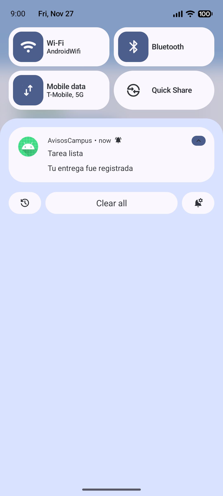
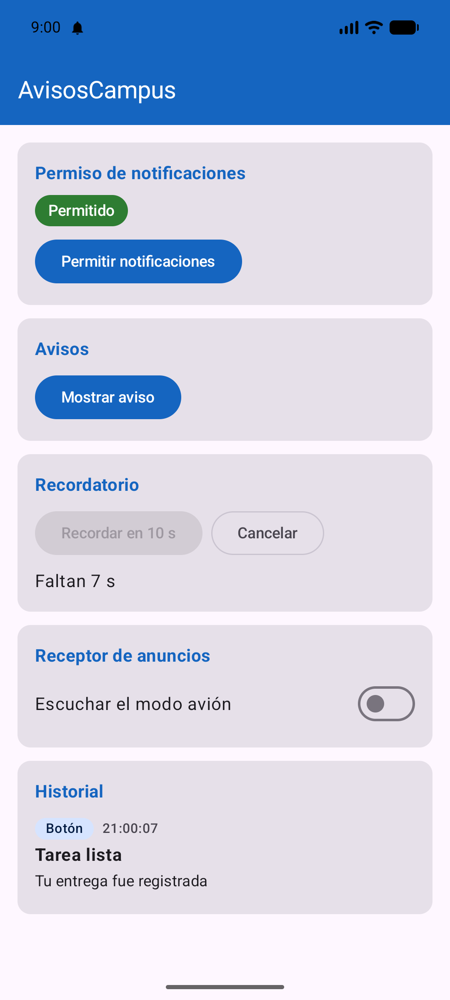
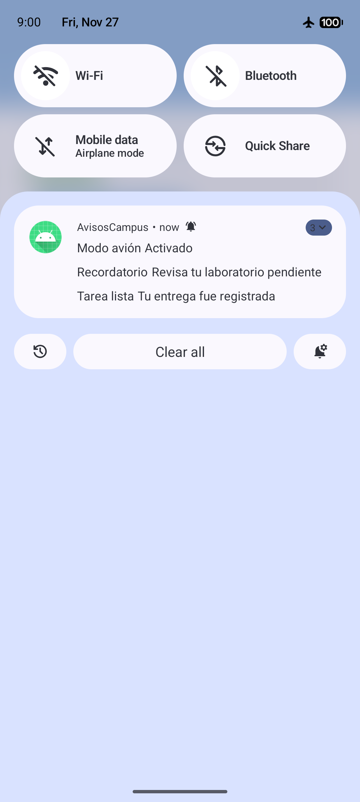
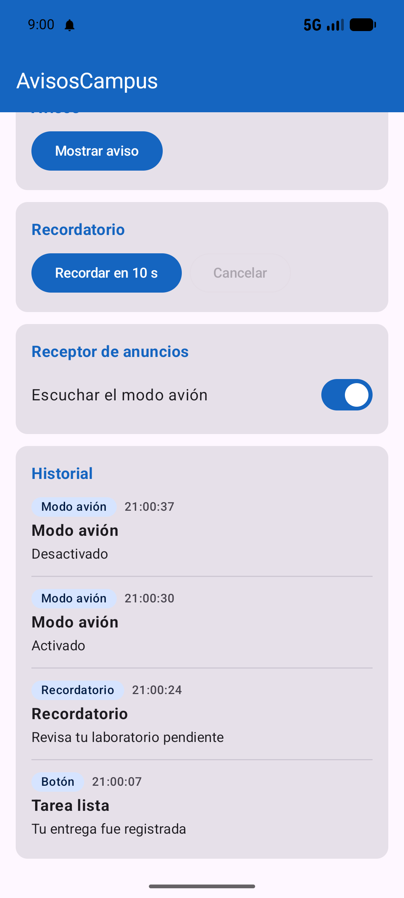
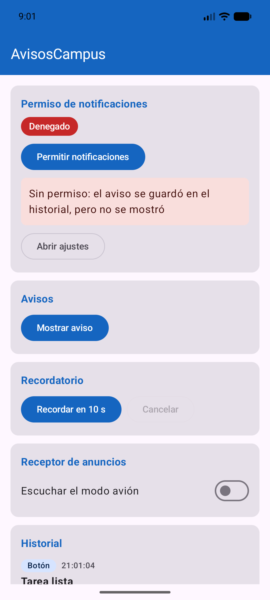
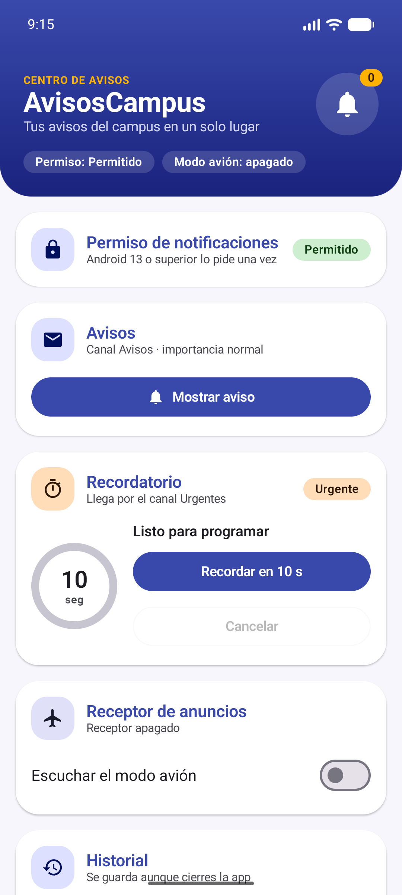
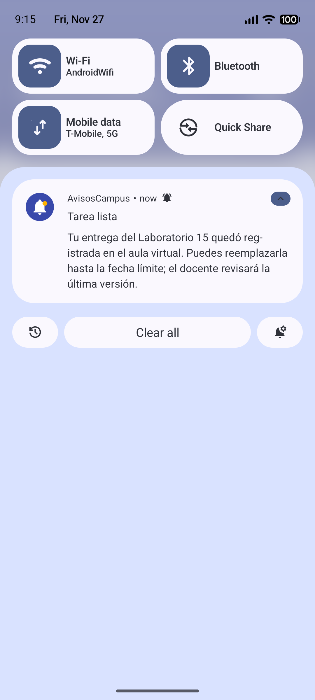
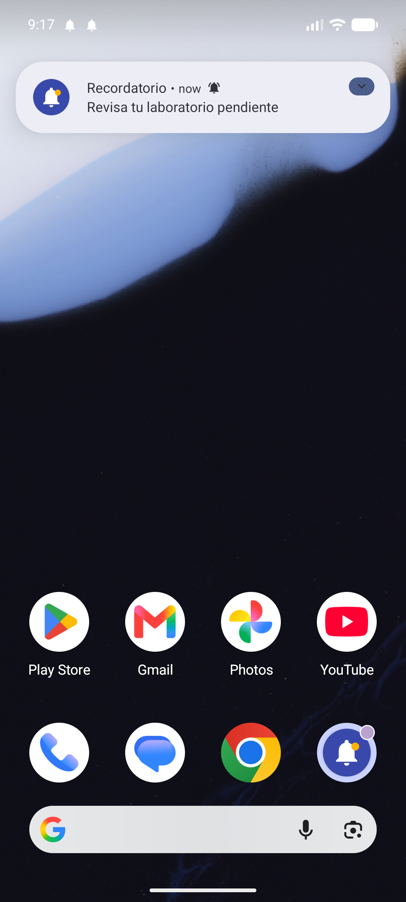
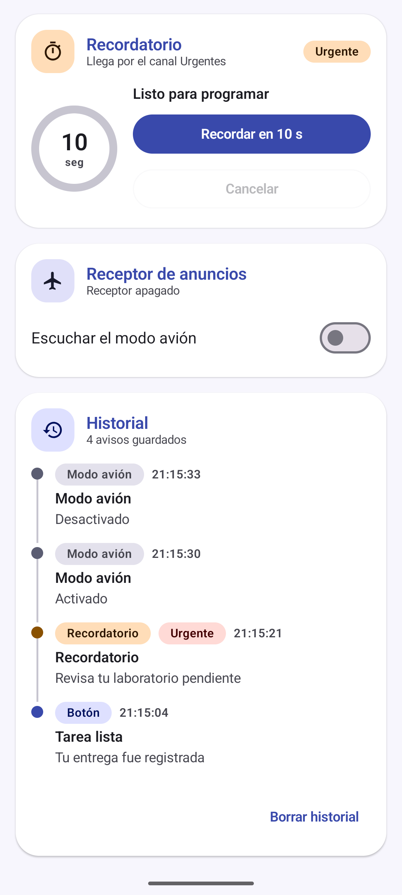
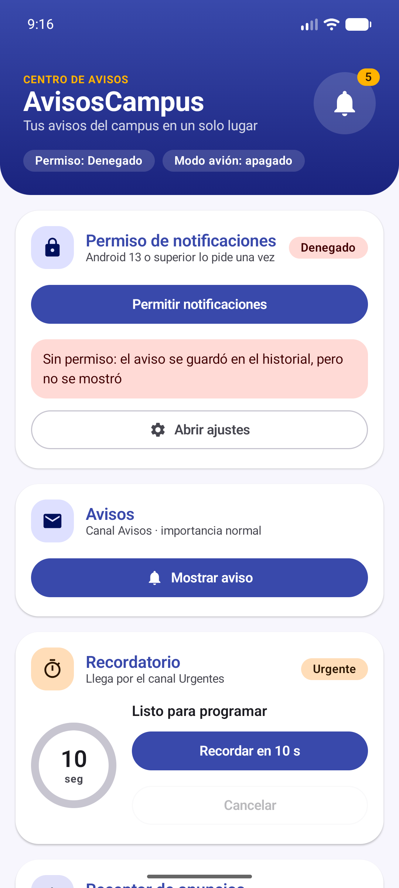

# AvisosCampus — Laboratorio 15 (Programación en Móviles)

**Alumno:** Diego Panez · **Paquete:** `com.tecsup.avisoscampus`

App Android en Kotlin con Jetpack Compose y Material 3 que muestra notificaciones locales y escucha lo que pasa en el celular. Con un botón muestra un aviso, con otro programa un recordatorio que llega a los 10 segundos y, si se activa el switch, avisa cuando se enciende o apaga el modo avión. Todo queda anotado en un historial. Usa solo datos ficticios.

## Qué hace

| Función | Detalle |
|---|---|
| Canal | Crea el canal «Avisos» una sola vez, en la clase `Application` |
| Permiso | Pide `POST_NOTIFICATIONS` (Android 13+) y muestra Sin pedir, Permitido o Denegado |
| Avisos | «Mostrar aviso» lanza la notificación «Tarea lista»; al tocarla se abre la app |
| Recordatorio | «Recordar en 10 s» con cuenta regresiva y Cancelar |
| Receptor | Switch «Escuchar el modo avión» con un `BroadcastReceiver` |
| Historial | Los 20 avisos más recientes, con su origen y su hora |
| Permiso denegado | El aviso se guarda en el historial, se muestra un mensaje y el botón «Abrir ajustes» |

## Estructura de paquetes

```
com.tecsup.avisoscampus/
├── AvisosApp.kt                   Application: crea el canal
├── MainActivity.kt
├── model/
│   └── Modelos.kt                 Aviso, Origen y PermisoUi
├── data/
│   └── AvisosRepository.kt        interface + AvisosRepositoryMemoria
├── notificacion/
│   └── Notificador.kt             canal, permiso y mostrar
├── receiver/
│   └── ModoAvionReceiver.kt       escucha ACTION_AIRPLANE_MODE_CHANGED
├── viewmodel/
│   ├── AvisosViewModel.kt         estado, recordatorio y eventos
│   └── AvisosViewModelFactory.kt
└── ui/
    ├── PantallaAvisos.kt          las tarjetas, el permiso y el receptor
    ├── HistorialAvisos.kt         tarjeta Historial
    └── theme/
        └── Theme.kt
```

## Arquitectura MVVM + Repository

```
View (PantallaAvisos)
   |  eventos: botones, switch          ^  collectAsState()
   v                                    |
ViewModel (AvisosViewModel)  --- StateFlow (avisos, permiso, faltan...) --->
   |  registra el aviso
   |  emite: eventos (SharedFlow<Aviso>)
   v                                    v
AvisosRepository (interface)        View recibe el evento y llama a
  -> AvisosRepositoryMemoria        Notificador.mostrar(context, aviso)
```

- **View:** muestra el estado, avisa los eventos y, como sí tiene `Context`, llama al `Notificador` y registra el receptor.
- **ViewModel:** decide qué avisar, lo anota en el Repository y emite un evento. No usa `Context`, `NotificationManager` ni `BroadcastReceiver`.
- **Repository:** guarda el historial en memoria y no sabe nada de la interfaz.
- **Notificador:** es lo único que habla con el sistema de notificaciones (canal y `NotificationManagerCompat`).

## Capturas

| Notificación en el panel | Recordatorio | Modo avión |
|---|---|---|
|  |  |  |

| Historial | Permiso denegado |
|---|---|
|  |  |

## Pruebas de aceptación

Probadas en el emulador Pixel 8 (API 37).

| Prueba | Resultado esperado | OK |
|---|---|---|
| Ajustes → Apps → AvisosCampus → Notificaciones | Existe el canal Avisos | ✔ |
| Pulsar Permitir notificaciones | Aparece el cuadro de Android y la etiqueta cambia | ✔ |
| Pulsar Mostrar aviso | Aparece la notificación Tarea lista | ✔ |
| Pulsar Mostrar aviso dos veces | Aparecen dos notificaciones distintas | ✔ |
| Tocar la notificación | Se abre la app y la notificación desaparece | ✔ |
| Recordar en 10 s | Cuenta regresiva y aviso al llegar a 0 | ✔ |
| Recordar y minimizar la app | El aviso llega igual | ✔ |
| Recordar y cancelar | No llega ningún aviso | ✔ |
| Switch activado y cambiar el modo avión | Aviso Activado y luego Desactivado | ✔ |
| Switch desactivado y cambiar el modo avión | No hay aviso | ✔ |
| Permiso denegado y Mostrar aviso | Mensaje de error, aviso en el historial y la app no se cierra | ✔ |
| Rotar la pantalla durante el recordatorio | La cuenta regresiva continúa | ✔ |
| Revisar el código | No hay `Context` en `viewmodel/` y el receptor se quita en `onDispose` | ✔ |

## Fase 2 — Mejoras con IA (rama `con-ia`)

El registro de prompts está en [PROMPTS.md](PROMPTS.md) y el diseño de la base de datos en [docs/BaseDeDatos.md](docs/BaseDeDatos.md).

| Mejora | Capas que cambian | Cómo funciona |
|---|---|---|
| Dos canales | Notificador + ViewModel | Canal «Urgentes» con `IMPORTANCE_HIGH` (emergente) además de «Avisos». El ViewModel marca el recordatorio como `urgente` y el `Notificador` elige el canal |
| Texto largo | Notificador | `BigTextStyle` muestra el texto completo al expandir la notificación |
| Historial persistente | Repository + ViewModel | Room guarda los avisos en SQLite. El Repository expone un `Flow` y el ViewModel lo convierte con `stateIn`. El id usa `AUTOINCREMENT` y nunca se repite. Botón «Borrar historial» |
| Rediseño | ui/theme + ui/components | Identidad «Campus índigo» (ver abajo) |

Paquetes nuevos en la Fase 2:

```
com.tecsup.avisoscampus/
├── data/
│   ├── AvisosRepositoryRoom.kt    historial en SQLite
│   └── local/
│       ├── AppDatabase.kt
│       ├── dao/AvisoDao.kt
│       └── entity/AvisoEntity.kt
├── di/
│   └── AppContainer.kt            se crea en AvisosApp
└── ui/
    ├── components/                Cabecera y Componentes compartidos
    └── theme/                     Color, Type, Shape, Dimens y Theme
```

### Sistema de diseño: «Campus índigo»

| Decisión | Elección |
|---|---|
| Personalidad | Ordenada y confiable, como el tablero de avisos de un campus |
| Color semilla | Índigo `#3949AB` con acento ámbar `#FFB300` para lo urgente y la cuenta regresiva |
| Formas | Amables: tarjetas de 24 dp, etiquetas tipo píldora, cabecera con esquinas inferiores de 32 dp |
| Tipografía | Escala propia de Material 3: títulos en negrita y texto de 14 a 16 sp |
| Imágenes | Íconos vectoriales por sección (candado, sobre, reloj, avión, historial) y campana índigo como ícono de la app y de la notificación |
| Pantalla | Cabecera con degradado, contador de avisos y estado; tarjetas con ícono; anillo de cuenta regresiva; historial como línea de tiempo |

Las pantallas solo usan `MaterialTheme.colorScheme`, `typography`, `shapes` y `Dimens`; la auditoría de diseño no encontró valores escritos a mano.

### Capturas de la Fase 2

| Diseño nuevo | Texto largo | Canal Urgentes |
|---|---|---|
|  |  |  |

| Historial guardado tras cerrar la app | Permiso denegado |
|---|---|
|  |  |

## Para pensar

**1. ¿Por qué una notificación necesita un canal y un permiso? ¿Qué pasa si falta cada uno?**
El canal agrupa las notificaciones por tipo y deja que la persona decida, en Ajustes, cuáles quiere y con qué importancia. Desde Android 8, una notificación sin canal no se muestra. El permiso `POST_NOTIFICATIONS` (Android 13+) es la autorización de la persona para que la app la moleste. Sin permiso, `notify` no muestra nada: por eso `mostrar` lo revisa primero y devuelve `false`.

**2. ¿Por qué el ViewModel emite un evento y no muestra la notificación él mismo?**
Para mostrarla se necesita un `Context`, y el ViewModel vive más que la pantalla: si guardara un `Context` de la Activity, al rotar quedaría apuntando a una pantalla destruida y se filtraría memoria. El ViewModel solo decide qué avisar y lo anota; la pantalla, que sí tiene `Context`, recibe el evento y llama al `Notificador`. Así el ViewModel se puede probar sin Android.

**3. ¿Qué pasa si usas el mismo id en dos notificaciones?**
La segunda reemplaza a la primera: en el panel se ve una sola. Por eso se usa el `id` del aviso, que el Repository aumenta en cada registro, y al pulsar dos veces aparecen dos notificaciones.

**4. ¿Por qué onReceive debe ser corto y por qué hay que quitar el receptor al salir?**
`onReceive` corre en el hilo principal: si tarda, congela la app, y si pasa de unos segundos Android lo corta. Por eso solo lee el estado y lo pasa al ViewModel. El receptor registrado guarda una referencia a la pantalla; si no se quita con `unregisterReceiver` en `onDispose`, sigue vivo después de salir, se filtra memoria y puede avisar dos veces.

**5. ¿En qué casos usarías una notificación local y en cuáles una push de Firebase?**
Local, cuando la app misma sabe qué avisar y cuándo: un recordatorio, el fin de una descarga o un cambio en el celular, como el modo avión. Push de Firebase, cuando el aviso nace en un servidor o en otra persona: un mensaje nuevo, una nota publicada o una oferta, y debe llegar aunque la app esté cerrada.
