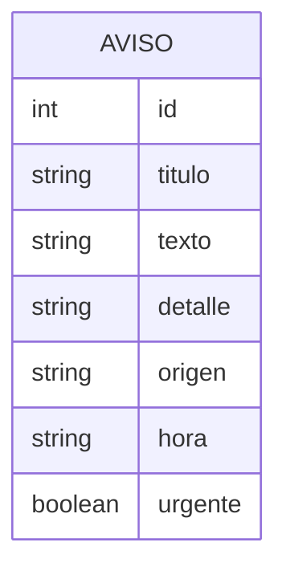
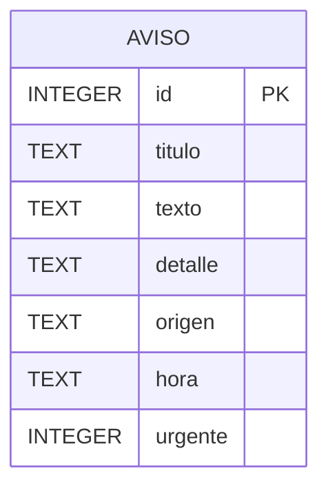

# Base de datos — AvisosCampus

En la Fase 1 el historial vivía en memoria y se perdía al cerrar la app. En la Fase 2 se guarda en SQLite con Room. La base es pequeña, pero se diseñó en los 4 pasos del curso.

## 1. Modelo conceptual

**Entidades**

| Entidad | Descripción | Atributos principales |
|---|---|---|
| Aviso | Algo que la app avisó a la persona | título, texto, detalle, origen, hora, urgente |

**Lo que no es entidad**

- **Origen** (Botón, Recordatorio, Modo avión): es una lista fija de tres valores definida en el código (`enum class Origen`). No tiene datos propios que cambien ni se agregan orígenes desde la app, así que se guarda como un valor dentro del aviso.
- **Permiso, cuenta regresiva y switch del modo avión**: son estado de la pantalla, no datos que deban guardarse.

**Reglas de negocio**

- Cada aviso tiene un número único que también es el id de su notificación. Nunca se reutiliza, aunque se borre el historial: si se reutilizara, una notificación nueva podría reemplazar a otra.
- El historial se muestra con lo más reciente arriba y solo los 20 últimos.
- La hora es la del momento en que se registró el aviso y no cambia.

## 2. MER



No hay relaciones: el sistema tiene una sola entidad. Origen no se modela como entidad aparte (ver paso 1), así que no hay 1:N ni N:M que resolver.

## 3. Modelo lógico

| Tabla | Columna | Clave | Descripción |
|---|---|---|---|
| aviso | id | PK | Número del aviso y de su notificación |
| aviso | titulo | | «Tarea lista», «Recordatorio» o «Modo avión» |
| aviso | texto | | Texto corto de la notificación |
| aviso | detalle | | Texto largo al expandir (puede faltar) |
| aviso | origen | | BOTON, RECORDATORIO o MODO_AVION |
| aviso | hora | | Hora del registro, HH:mm:ss |
| aviso | urgente | | Si salió por el canal Urgentes |



**Normalización**

- **1FN:** cada columna guarda un solo valor; no hay listas ni columnas repetidas.
- **2FN:** la PK es simple (`id`), así que ningún atributo puede depender de una parte de ella.
- **3FN:** ningún atributo depende de otro que no sea la clave. Se revisó `origen`: su etiqueta para la pantalla («Botón», «Modo avión») depende del origen y no del aviso, por eso **no se guarda** la etiqueta; se guarda solo el nombre (`MODO_AVION`) y la etiqueta sale del `enum`. Guardar las dos sería redundante.

## 4. Modelo físico

```sql
CREATE TABLE aviso (
    id       INTEGER PRIMARY KEY AUTOINCREMENT NOT NULL,
    titulo   TEXT    NOT NULL,
    texto    TEXT    NOT NULL,
    detalle  TEXT,
    origen   TEXT    NOT NULL,            -- BOTON | RECORDATORIO | MODO_AVION
    hora     TEXT    NOT NULL,            -- HH:mm:ss
    urgente  INTEGER NOT NULL DEFAULT 0   -- 0 = no, 1 = sí
);
```

- `AUTOINCREMENT` impide reutilizar un id aunque se borren filas: cumple la regla del id único de la notificación.
- No se necesita índice extra: la consulta ordena por `id`, que ya es la PK.
- Room no soporta `CHECK`; que `origen` sea uno de los tres valores lo asegura el tipo `Origen` en Kotlin.

**Traducción a Room**

| Tabla física | @Entity | DAO | Repository |
|---|---|---|---|
| aviso | `data/local/entity/AvisoEntity.kt` | `data/local/dao/AvisoDao.kt` (`observarTodos`, `insertar`, `borrarTodos`) | `data/AvisosRepositoryRoom.kt` |

`AvisoEntity` guarda `origen` como `String` (`Origen.name`) y el Repository lo convierte en `Origen` con `Origen.valueOf`. La pantalla nunca ve la entidad: el Repository la traduce al modelo `Aviso`.

## Datos de prueba

No hay datos iniciales: el historial empieza vacío y se llena con los avisos que genera la app.
